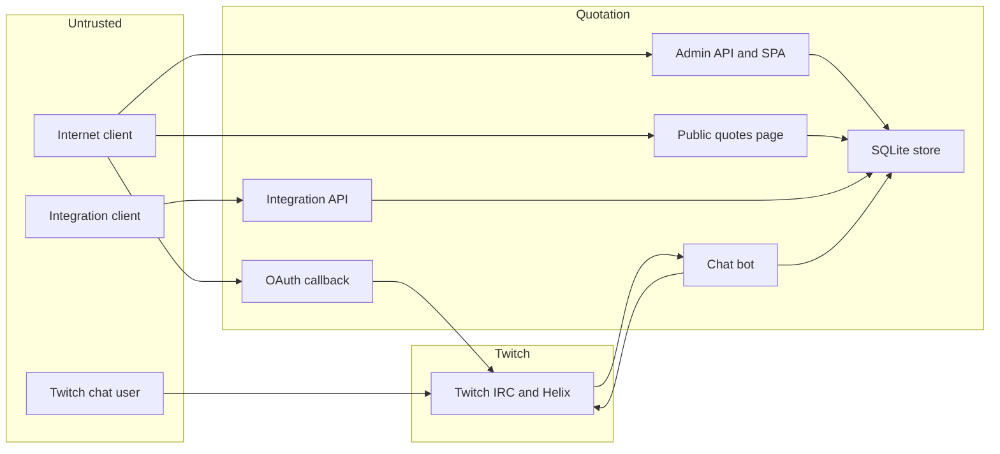

# Quotation threat model

Generated 2026-11-19 with OpenAI's `security-threat-model` skill, run through Claude Code. Evidence anchors are repo paths and symbols. No secrets were read or reproduced.

## Executive summary
The top risk is the admin WebUI and API being reachable from the internet, which the owner confirmed may be the case. Admin access rests on one shared password plus a signed cookie. The login brute-force limit is keyed on `req.ip`, and `TRUST_PROXY` defaults to `1`. Without a real proxy in front, an attacker can spoof `X-Forwarded-For` and get unlimited guesses. A successful login gives full control of the quotes, the Twitch client secret and bot token, the public-page switch and the integration API key. Second-tier risks are defence-in-depth gaps (no security headers on the admin app, CSRF relying only on `SameSite=Lax`, plaintext Twitch secrets in SQLite). The public quotes page and integration API are well contained: escaped output, strict CSP, restricted DTO, rate limits.

## Scope and assumptions
In scope: `server/src`, `shared/src`, `web/src`, `Dockerfile`, `entrypoint.sh`, `docker-compose.yml`, `.github/workflows/security.yml`. Out of scope: Twitch's own infrastructure, the Unraid host, SweevElements (the consumer of the integration API), and `docs/handoffs`. `.github/workflows/docker.yml` was not reviewed in detail; see the 2026-11-19 sweep report.

Assumptions (user-confirmed unless marked):
- Single streamer, single admin, one shared WebUI password. (assumed)
- The admin port (8766, and 8767 if `TLS_PORT` is set) may be reachable from the internet. (confirmed)
- Quotes are meant to be public via the public page. Everything else is meant to be private. (confirmed)
- Whether a reverse proxy sits in front is unknown, so `TRUST_PROXY` correctness is unknown. (open)
- Other containers (Whitelister, MultiplayerMarkdown) share the same host or IP on different ports. (from `CLAUDE.md`)

Open questions that change ranking:
1. Is 8766 forwarded straight from the router, or behind a proxy or tunnel that overwrites `X-Forwarded-For`? This decides whether TM-001 is high or low.
2. Is the admin traffic plain HTTP over the internet? If so, the password and session cookie are sniffable (TM-006).
3. Is the live `WEBUI_PASSWORD` long and random?

## System model
### Primary components
- Express app on `PORT` serving `/api/*`, the public quotes router, the Twitch OAuth router and the built SPA (`server/src/app.ts` `createApp`).
- Optional second Express app on `PUBLIC_PORT` serving only the public page (`createPublicApp`).
- Optional self-signed HTTPS listener on `TLS_PORT` serving the same app (`server/src/index.ts`).
- libsql/SQLite database holding quotes, backups, a key-value `settings` table and per-command config (`server/src/db/schema.ts`, `services/settingsService.ts`).
- tmi.js Twitch chat bot and command pipeline (`twitch/chatClient.ts`, `commandRouter.ts`, `commands/*`).
- Twitch Helix and OAuth clients (`twitch/helixClient.ts`, `twitch/oauth.ts`).
- React SPA (`web/src`), built by Vite and served by Express.

### Data flows and trust boundaries
- Internet → admin API (`/api/*`, PORT): JSON over HTTP(S). Auth is a `cookie-session` cookie (`quotation.session`, `httpOnly`, `sameSite=lax`, 7 days, no explicit `secure`). Validation is by zod schemas (`shared/src/schemas.ts`). Rate limit applies only to `/login` and `/change-password` (10 per 15 min per `req.ip`). No CSRF token.
- Internet → public quotes page (`/public/quotes`, on PORT and PUBLIC_PORT): GET only. No auth. Off by default (`public_page_enabled`). 90 requests per minute per IP. Strict nonce CSP, HTML-escaped output, restricted `PublicQuote` fields.
- Integration client → `/api/integration/v1/*`: API key (`qtn_` + 64 hex) via Bearer or `X-Api-Key`. SHA-256 hash stored, constant-time compare. 120 requests per minute per IP. Read-only.
- Twitch → `/twitch/callback`: unauthenticated GET with `code` and `state`. State is a 128-bit random value held in memory for 10 minutes and consumed once (`twitch/oauth.ts`). Error text is HTML-escaped under a nonce CSP.
- Twitch chat → command router: IRC messages over TLS via tmi.js. Roles come from Twitch-supplied badge tags. Follower tier uses a live Helix call. Cooldowns are in memory.
- Server → Twitch (`id.twitch.tv`, `api.twitch.tv`): HTTPS with fixed hosts. User-influenced values are `encodeURIComponent`-encoded.
- Server → SQLite: parameterised via drizzle. LIKE wildcards escaped.
- Admin browser → SSE `/api/events`: auth required, no per-user connection cap.

#### Diagram

## Assets and security objectives
| Asset | Why it matters | Objective |
|---|---|---|
| WebUI password hash and session secret | Gate all admin functions | C, I |
| Twitch client secret, bot access and refresh tokens (plaintext in `settings`) | Lets an attacker act as the bot account and call Twitch as the app | C, I |
| Quotes and backups | The product's core data. Public by design, but integrity matters | I, A |
| Integration API key hash | Controls access to the machine API | C |
| `SESSION_SECRET` | Forges any admin cookie if leaked | C |
| Bot availability and chat reputation | Bot spam or abuse can harm the channel | A, I |
| TLS private key in `DATA_DIR` | Impersonation of the self-signed listener | C |

## Attacker model
### Capabilities
- Remote anonymous client reaching the admin port, with full control of HTTP headers (including `X-Forwarded-For`).
- Any Twitch chat user, able to send `!quote` and attempt privileged commands.
- A moderator account (semi-trusted) able to run `!addquote`, `!editquote`, `!removequote` by default.
- A hostile page opened in the admin's browser, or a compromised sibling service on the same host or IP (same-site, different port).
- A network on-path attacker, if admin traffic is plain HTTP over the internet.

### Non-capabilities
- Cannot read the database or `data/` directory without code execution or host access.
- Cannot forge the session cookie without `SESSION_SECRET` (production start guard enforces 32+ chars).
- Cannot reach admin routes from `PUBLIC_PORT`, since that app mounts only the public router.
- No SQL, shell, file-path or template injection sinks were found.
- Cannot inject script into the SPA or public page via quote text (escaped everywhere reviewed).

## Entry points and attack surfaces
| Surface | How reached | Trust boundary | Notes | Evidence |
|---|---|---|---|---|
| `POST /api/auth/login` | Internet | Anonymous to admin | Rate limit keyed on `req.ip`, spoofable behind default `TRUST_PROXY=1` | `routes/auth.ts:12`, `middleware/rateLimit.ts:12`, `config/env.ts:38` |
| Authenticated admin API (quotes, settings, backups, integration key) | Cookie | Admin | No CSRF token, relies on `SameSite=Lax` | `app.ts:59-71`, `auth/session.ts:14` |
| SPA static files | Internet | Anonymous | No CSP, framing or nosniff headers, `X-Powered-By` on | `app.ts:52-79` |
| `/twitch/callback`, `/twitch/auth` (GET) | Internet | Anonymous | State-gated, output escaped, fixed redirect target | `routes/twitchOAuth.ts:57-90`, `twitch/oauth.ts:23-36` |
| `/public/quotes[/:id]` | Internet | Anonymous | Off by default, escaped, CSP, rate limited | `routes/publicQuotes.ts`, `services/publicQuotesPage.ts` |
| `/api/integration/v1/*` | API key | Linked app | Read-only, restricted DTO | `routes/integration.ts`, `services/integrationService.ts` |
| `/api/events` SSE | Cookie | Admin | Long-lived connections, no cap | `routes/events.ts` |
| Chat commands | Twitch IRC | Chat user to bot | Permission by badge, cooldowns, zod-free arg parsing | `twitch/commandRouter.ts`, `permissions.ts` |
| Backup and quote import | Cookie, JSON body | Admin | Zod-validated, max 5000 items, restore is transactional | `routes/backups.ts`, `services/backupService.ts` |
| TLS listener (`TLS_PORT`) | Internet | Anonymous | Same app, 10-year self-signed cert, key mode 0600 | `index.ts:30-36`, `tls/selfSignedCert.ts` |

## Top abuse paths
1. Admin takeover by password guessing: attacker sends unlimited `POST /api/auth/login` with a fresh `X-Forwarded-For` per request (no proxy overwrites it) → limiter never trips → bcrypt-cost-12 guessing at network speed against a weak `WEBUI_PASSWORD` → cookie issued → full admin.
2. Bot hijack after takeover: attacker reads Twitch settings, replaces the client secret or channel, or runs OAuth with their own app → bot account tokens or chat identity abused, or bot disconnected.
3. Data destruction after takeover: attacker deletes quotes, restores a crafted backup (import then restore), regenerates or revokes the integration API key. The `pre_restore` snapshots limit the damage, but only 7 are kept and the attacker can create 7 more.
4. Cross-site request from a sibling service: XSS in another container on the same host makes a simple credentialed `POST` with no body (create backup, regenerate API key, restore backup) to Quotation; `SameSite=Lax` does not isolate ports.
5. Quote defacement via a moderator or compromised mod account: `!addquote` or `!editquote` plants abusive text that is relayed in chat and shown on the public page.
6. Session sniffing: admin logs in over plain HTTP across the internet → password and cookie captured → replay for up to 7 days.
7. Secret theft from a stolen backup of `data/` or the SQLite file: plaintext Twitch client secret and tokens usable immediately.
8. SSE connection exhaustion by an authenticated session holder: negligible, listed for completeness.

## Threat model table
| Threat ID | Threat source | Prerequisites | Threat action | Impact | Impacted assets | Existing controls (evidence) | Gaps | Recommended mitigations | Detection ideas | Likelihood | Impact severity | Priority |
|---|---|---|---|---|---|---|---|---|---|---|---|---|
| TM-001 | Remote anonymous | Admin port reachable and no proxy overwriting `X-Forwarded-For` | Spoof `X-Forwarded-For` to bypass the login limiter and brute-force the password | Full admin takeover | Password, Twitch secrets, quotes | 10 attempts per 15 min per IP (`routes/auth.ts:12`); bcrypt cost 12 (`auth/password.ts:4`) | Default `TRUST_PROXY=1` (`config/env.ts:38`) trusts a header nobody overwrites; limiter is per IP only, no global or per-account lockout; not documented in README, compose or `.env.example` | Default `TRUST_PROXY` to 0 or require it explicitly; add a global failed-login cap or backoff; document the setting in `.env.example` and compose | Log failed logins with the resolved IP; alert on many 401s | high | high | high |
| TM-002 | Remote anonymous | Weak `WEBUI_PASSWORD` | Guess a weak seed password | Admin takeover | Password | Production guard rejects only the literal `change-me` (`config/env.ts:49`); change-password needs 8+ chars (`shared/schemas.ts:13`) | No minimum length or strength check on the env seed password | Enforce a minimum length (for example 12) in the production guard | None needed beyond TM-001 | medium | high | medium |
| TM-003 | Hostile page or sibling service | Victim admin logged in; attacker origin is same-site (different port) or a browser without Lax enforcement | Credentialed simple request with no body to a state-changing route | Backup spam, API key regenerated, restore, logout | Quotes, integration key | `SameSite=Lax` (`auth/session.ts:18`); JSON-only body parsing blocks body-bearing cross-site posts (`app.ts:59`) | No CSRF token, no Origin check, no custom header; `SameSite` is site-scoped, not port-scoped | Require a custom header (for example `X-Requested-With`) or check `Origin` on non-GET `/api` routes | Log rejected origins | low | medium | medium |
| TM-004 | Remote anonymous | Admin app served without headers | Clickjacking, MIME sniffing, no CSP safety net if an XSS ever lands | Defence in depth only today | Session, admin actions | `SameSite=Lax` blocks credentialed framing in modern browsers; SPA escapes by default (no `dangerouslySetInnerHTML` found in `web/src`) | No helmet, CSP, `frame-ancestors`, nosniff or referrer policy on the main app (`app.ts:52-79`); `X-Powered-By` on | Add `helmet()` with a CSP that allows the Google Fonts origins, or self-host the font | CSP report-only first | low | medium | low |
| TM-005 | Host or backup access | Read access to `data/` or a copy of the SQLite file | Read plaintext Twitch client secret and bot tokens | Bot and app impersonation | Twitch secrets | File lives on a bind mount owned by uid 99 (`entrypoint.sh`); client secret never returned by the API (`routes/settings.ts:42-48`) | Secrets stored unencrypted (`twitch/oauth.ts:66-71`, `routes/settings.ts:64`) | Encrypt at rest with a key derived from a separate env secret, or document the trust in host permissions; keep bot scopes minimal (already minimal) | None | low | high | medium |
| TM-006 | On-path attacker | Admin over plain HTTP across the internet | Capture password and cookie | Admin takeover | Password, session | Cookie `secure` auto-detected per request (`auth/session.ts:7-13`) so it is set over HTTPS | The bundled TLS listener is self-signed; plain HTTP stays enabled on the same app | Use a real HTTPS reverse proxy or VPN for any remote admin access; do not forward 8766 | n/a | medium | high | medium (conditional on internet exposure) |
| TM-007 | Moderator or compromised mod | Moderator badge | Plant abusive quote text via `!addquote` or `!editquote`, shown in chat and on the public page | Reputation harm, possible Twitch moderation action on bot | Quotes, bot account | Escaped output on the public page; leading `/` or `.` neutralised (`services/templateService.ts:17`); permission levels configurable (`services/settingsService.ts:67-98`) | No content filter; no length trim for chat replies (Twitch limit 500 chars vs 2000-char quotes) | Keep `addquote` and `editquote` at moderator or higher; review quotes via the WebUI; consider truncating replies | Activity log already records who ran what (`events/bus.ts`) | medium | low | low |
| TM-008 | Session cookie thief | A stolen cookie (malware, shared PC) | Reuse the cookie after logout | Admin access for up to 7 days | Session | Password change invalidates old cookies (`middleware/requireAuth.ts:6-10`) | Logout only clears the client cookie; no server-side revocation list | Shorten `maxAge`, or add a server-side session epoch that logout bumps | None | low | medium | low |
| TM-009 | Unauthenticated visitor | Public page enabled | Scrape or flood the public page | Load only | Availability | 90 per minute per IP (`routes/publicQuotes.ts:22`), page cap 1000, search length 100 | Limiter is per IP, so a spoofed header (TM-001 condition) bypasses it; in-memory map capped at 5000 | Set `TRUST_PROXY` correctly; keep the public port behind a tunnel or CDN | Request logs | medium | low | low |

## Criticality calibration
- **Critical**: pre-auth code execution, a way to read or forge admin sessions without the password, or remote read of the Twitch secrets. None found.
- **High**: unauthenticated admin takeover in realistic deployment (for example a bypassable login limiter on an internet-exposed admin port); theft of the bot's Twitch tokens.
- **Medium**: weak-password acceptance, plaintext secret storage, CSRF exposure that needs a same-site foothold, sniffable admin traffic.
- **Low**: missing defence-in-depth headers, no server-side session revocation, quote defacement by an already-trusted moderator, public page load.

## Focus paths for security review
| Path | Why it matters | Related Threat IDs |
|---|---|---|
| `server/src/middleware/rateLimit.ts` | Per-IP key trusts `req.ip`, which depends on `TRUST_PROXY` | TM-001, TM-009 |
| `server/src/config/env.ts` | `TRUST_PROXY` default and the production secret guard | TM-001, TM-002 |
| `server/src/routes/auth.ts` | Login and password change, shared limiter | TM-001, TM-002 |
| `server/src/auth/session.ts` | Cookie flags and lifetime | TM-003, TM-006, TM-008 |
| `server/src/app.ts` | Middleware order, missing headers, public and admin routing | TM-003, TM-004 |
| `server/src/twitch/oauth.ts` | Plaintext token storage and OAuth state | TM-005 |
| `server/src/routes/settings.ts` | Twitch secret write path and integration key lifecycle | TM-003, TM-005 |
| `server/src/routes/backups.ts`, `services/backupService.ts` | Destructive restore, import validation | TM-003 |
| `server/src/twitch/commandRouter.ts`, `permissions.ts` | Role checks for chat commands | TM-007 |
| `server/src/services/publicQuotesPage.ts`, `routes/publicQuotes.ts` | The only unauthenticated HTML surface | TM-009 |
| `Dockerfile`, `entrypoint.sh`, `docker-compose.yml` | Non-root drop, port exposure defaults | TM-001, TM-006 |

## Quality check
- [x] Entry points covered: login, admin API, SPA, OAuth callback, public page, integration API, SSE, chat commands, imports, TLS listener.
- [x] Trust boundaries each appear in at least one threat.
- [x] Runtime separated from CI and dev: CI (`security.yml`, `docker.yml`) was only skim-reviewed; the 2026-11-19 sweep covers it.
- [x] User clarifications reflected: admin may be internet-reachable; quotes public, admin private; proxy topology unknown (recorded as open question).
- [x] Assumptions and open questions listed above.

## Update: Cloudflare in front (user-confirmed 2026-11-19)
Access from the internet goes through Cloudflare, so the proxy-topology question is answered: set `TRUST_PROXY=1` (one hop). Cloudflare appends the real client IP to `X-Forwarded-For`, and Express with one trusted hop reads the rightmost entry, so a client-supplied header can't spoof it. That downgrades TM-001 and TM-009 to low, and TM-006 (plain-HTTP sniffing) is covered by Cloudflare's TLS. Conditions: the origin must not be reachable except through Cloudflare (use a Cloudflare Tunnel, or firewall the origin to Cloudflare's IP ranges), otherwise direct hits can still spoof. Recommended: put Cloudflare Access (SSO or one-time PIN) in front of the admin hostname, and route only `/public/quotes*` publicly.
